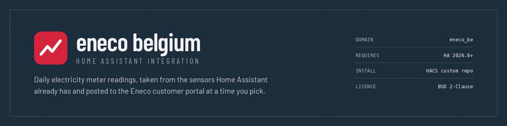

<p align="center">
  
</p>

<p align="center">
  <a href="https://github.com/renaudallard/homeassistant_eneco/releases/latest">
    
  </a>
  <a href="https://github.com/renaudallard/homeassistant_eneco/releases">
    
  </a>
  <a href="https://github.com/renaudallard/homeassistant_eneco/actions/workflows/checks.yml">
    
  </a>
  <a href="https://github.com/renaudallard/homeassistant_eneco/actions/workflows/hassfest.yml">
    
  </a>
  <a href="https://github.com/renaudallard/homeassistant_eneco/actions/workflows/hacs.yml">
    
  </a>
  <a href="https://www.home-assistant.io/">
    
  </a>
  <a href="https://hacs.xyz">
    
  </a>
  <a href="./LICENSE">
    
  </a>
  <a href="https://www.paypal.me/RenaudAllard">
    
  </a>
</p>

---

Sends your electricity and gas meter readings to the Eneco Belgium customer
portal once a day, taking the values from sensors Home Assistant already has.

Eneco lets you enter meter readings by hand at
*My Eneco > Consommation > Encoder un relevé*. If your smart meter is already in
Home Assistant, doing that by hand every day is pointless work. This integration
reads the index of each register from the sensors you choose and posts them to
the portal at a time you pick.

Requires Home Assistant **2026.8** or newer.

## What it does

At the configured local time, once a day, it:

1. reads the current value of the sensor you chose for each register,
2. rounds it to whole kWh for electricity, or whole m³ for gas,
3. posts the set to Eneco, dated today.

Which registers exist is decided by Eneco, not by this integration: it asks the
portal which ones your meter accepts and only offers those. A dual tariff
electricity meter with solar panels typically has four (consumption day,
consumption night, injection day, injection night); a gas meter has one.

**Every register is optional.** Leave one without a sensor and it is simply not
part of the submission, which is what you want when a meter is still read by
hand, or when only some of its registers reach Home Assistant.

**One entry per login, one meter under it per connection.** The entry holds
your My Eneco credentials and signs in once; each electricity or gas meter it
submits for sits under it, with its own device, sources and time. You can have
either kind without the other, and add the second one later without signing in
again.

Among the registers you *did* map, a submission is all or nothing. If one of
those sensors is unavailable or does not report a usable number, nothing is sent
and the reason is recorded, because a partial set would record an incoherent
moment across the registers and the date cannot be submitted again to correct
it.

## Installation

### Home Assistant Marketplace or HACS

Search for **Eneco Belgium** under *Settings > Marketplace* (Home Assistant
2026.11 and later), or in HACS on an older version, install it and restart
Home Assistant. If it is not listed yet, add this repository as a custom
repository of type *Integration* first. Releases ship as a single archive, so
downloading one is a single request rather than a file at a time.

### Manually

Copy `custom_components/eneco_be` from a checkout into the `custom_components`
directory of your Home Assistant `config`, so that
`config/custom_components/eneco_be/manifest.json` exists, and restart. The
`eneco_be.zip` on a release holds those same files at its root, so unpack that
one into a `custom_components/eneco_be` you make yourself.

## Setup

*Settings > Devices & services > Add integration > Eneco Belgium*.

1. **Credentials.** The email and password of your My Eneco account.
2. **Account, address, meter.** Only asked when you have more than one; the
   integration skips straight past any step with a single answer.
3. **Meter readings.** A sensor per register, each optional, and the time of day
   to submit. The time offered is drawn at random from between 22:30 and 23:50,
   so that the households running this do not all reach Eneco in the same
   second. Change it to whatever suits you; it is only a suggestion, and only a
   meter that has not chosen one is given it.

That sets up the login with its first meter. To add the other one, a gas meter
next to an electricity meter for instance, open the integration page and choose
*Add meter* on the entry. It goes through the same steps from the account on,
using the login the entry is already signed in with, and only offers meters
that are not set up yet: an address with one meter of each kind goes straight
to the one that is missing. Adding the integration a second time with the same
login is refused and points you there instead.

The sensor for a register must be a *total* index, the same number you would
read off the meter, not a rate or a daily delta. The picker lists only sensors
carrying the right device class, energy for an electricity meter and gas for a
gas meter, so a template sensor without one has to be given it before it shows
up. For electricity that is an energy sensor in kWh; on a Belgian digital meter
these are the ones your P1 or DSMR integration exposes as "total consumption
tariff 1", "total production tariff 2", and so on. For gas it is a sensor with
the gas device class, read in m³, not one published as a volume. Other units of
the same kind are converted automatically.

## Entities

Every meter creates one device, named after its EAN, with:

| Entity | Purpose |
| --- | --- |
| `time.*_submit_at` | The time of day readings are sent; change it here and the schedule moves immediately |
| `sensor.*_next_submission` | When the next submission is due, shown as a countdown |
| `button.*_submit_readings` | Submit the readings now |
| `sensor.*_last_submission` | When the last submission succeeded |
| `sensor.*_status` | How the last attempt went, with the reason as an attribute |
| `sensor.*_last_yearly_bill` | The last full year billed, line by line, with [Read bills](#reading-bills) on |
| `sensor.*_tariff_card` | The tariff card the contract is billed on, with [Read bills](#reading-bills) on |
| `sensor.*_bill_difference` | What the year was billed above what a price integration prices it at, with [Read bills](#reading-bills) on |
| `binary_sensor.*_bill_disagrees` | On when the bill disagrees with that price integration, with [Read bills](#reading-bills) on |
| `sensor.*_monthly_advance_needed` | The monthly advance the meter needs, with [Read bills](#reading-bills) on |
| `sensor.*_current_advance` | What Eneco bills the meter's contract each month now, with [Read bills](#reading-bills) on |

`sensor.*_status` reads `pending` before the first attempt, then `success`,
`already_submitted` when the date was already done, `nothing_to_submit` when no
register has a sensor, or `failed` with the reason in its `last_error`
attribute. Three failures in a row also raise a repair card under
*Settings > System > Repairs*, naming the meter by the last four digits of its
EAN. It clears on the next attempt that does not fail, and it survives a
restart. Disabling the entry takes the cards of its meters down and enabling it
again brings them back; removing a meter, or the entry, takes them away for
good. While the login itself cannot be set up, as when the portal is down at
start, no submission is attempted and so no card is raised: the entry shows as
retrying on the integrations page instead.

Press the button from an automation if you want a different schedule than the
built-in daily one. A press that cannot submit fails the service call with the
reason, so a script notices; a press on a day that is already done, or with no
register mapped, is a no op rather than an error.

Use *Download diagnostics* on the entry to see, for every meter, what was last
sent, whether the last run was skipped or found nothing mapped, and how many
attempts have failed in a row, and with *Read bills* on, which card and bill
were read and why a newer one was not. Your email address, password, account number, EAN and address are left
out of it, and the account number is kept out of the log as well. The entry is
titled with a masked form of your email address, such as `s•••@e•••.com`,
because Home Assistant writes entry titles into its own log lines; rename it if
you prefer something else. The name stays through a *Reconfigure*, unless it
signs in with another email, which puts that one's masked form back.

What the last attempt did is remembered across restarts, so the sensors carry on
reporting the real last submission rather than resetting, and a day that was
already submitted is not sent again after a restart.

A wall clock trigger cannot fire while Home Assistant is down, so if the
configured time has already gone by when it starts and today has not been
submitted yet, the readings are sent rather than the day being lost. That
happens once Home Assistant has finished starting, not while it is still
loading, so the sensors it reads have had a chance to publish a value; the
time going by while it loads is left to that too. It also
means a freshly configured meter submits as soon as you finish setting it up, if
you chose a time earlier in the day.

## Changing the configuration

To move the **submission time**, set the `time.*_submit_at` entity on the device
page. The schedule is rearmed as soon as you change it, and
`sensor.*_next_submission` updates to match.

To change **which sensor feeds which register**, open the integration page,
click the three dots on the meter and choose *Change sources*. The registers are
asked of Eneco again, so a replaced meter shows the ones it has now, and the
form comes up prefilled with your current mapping and time. Neither this nor
moving the time signs in again.

Either change submits straight away when the time has already gone by today
and today's readings have not gone through, so a source fixed after a failed
attempt, or a time moved before now, does not wait for tomorrow. Setting the
time it already has is no change, and a change made while a submission is
running leaves that one to finish.

*Reconfigure*, on the entry, changes the credentials, which is what you want if
the email address you sign in to Eneco with has changed. The meters stay as
they are, so the new login has to reach the account of every one of them. If
Eneco stops accepting the stored password, Home Assistant raises a
reauthentication prompt by itself; that one asks for the password alone,
because it is there to re-establish the login the entry already belongs to.
Until it is entered there, or in *Reconfigure*, the refused password is not
tried again while the entry stays loaded, so the failures do not add up to a
locked account on the portal; a restart or a reload of the entry tries it
once more. Entering the same
one again tries it again, for an account that was only locked for a while.

## Reading bills

Off by default. To turn it on, click *Configure* on the entry and tick *Read
bills*. Once a day the integration then lists your invoices and reads the
last full year billed for each meter. The year is the one Eneco billed, never
a count of days, as the meter is read whenever Eneco gets to it: the newest
yearly or closing bill, however many days it covers, together with the
intermediary bills of that year (one comes with a product change, for
instance). Newest means by the days a bill covers, as the invoice list gives
them, not by when it was issued, so a bill issued late takes its own place.
An intermediary bill newer than the last yearly one waits for the yearly
bill that closes its year. On monthly billing the year is the last
twelve monthly bills. Each bill has to start the day after the one before it
ends, and no line is ever cut or spread over days, so every line shown is one
a bill prints. Each is the same PDF *My Eneco > Factures* offers for
download, and their billing lines become more sensors per meter:

| Entity | Purpose |
| --- | --- |
| `sensor.*_last_yearly_bill` | What the year cost for the meter, VAT included, in EUR |
| `sensor.*_tariff_card` | The version of the card the contract is billed on, such as `012210` |
| `sensor.*_bill_difference` | The year billed less what a price integration prices it at, VAT included, in EUR |
| `binary_sensor.*_bill_disagrees` | Problem when the bill disagrees with that price integration, OK when it agrees |
| `sensor.*_monthly_advance_needed` | The monthly advance the meter needs, VAT included, in EUR |
| `sensor.*_current_advance` | What Eneco bills the meter's contract each month now, VAT included, in EUR |

and two for each delivery address, on a device of its own named *Eneco
advance*:

| Entity | Purpose |
| --- | --- |
| `sensor.eneco_advance_monthly_advance_needed` | The monthly advance the address needs, gas and electricity together, in EUR |
| `sensor.eneco_advance_current_advance` | What Eneco bills the address each month now, in EUR |

The total is each line with its own VAT rate, added up, so it can be a cent off
what a bill prints. It is the cost of the year, not what was left to pay on the
bill: the advances paid during the year are not taken off. That is the
`balance` attribute, what the bills asked for once the advances were taken
off, in EUR with VAT, negative when Eneco refunded. It comes from the invoice
list rather than the PDF, and on bills issued before late 2025 can be a few
cents off what they print. A sensor created while it was still called *Last
bill* keeps its entity ID, `sensor.*_last_bill`.

`sensor.*_last_yearly_bill` has `period_start` and `period_end`, the first and
last day billed, `issued`, the day the newest of the bills was issued,
`balance`, `bills`, the `invoice_type`, `issued`, `period_start` and
`period_end` of each bill taken, oldest first, and a `lines` attribute listing
every billed line of them:

```yaml
- section: energy        # energy, network or taxes, as the bill groups them
  label: Conso. simple
  code: Energiecomponent ElectricityAplusTH   # printed on electricity bills only
  start: "2026-01-01"
  end: "2026-01-31"
  quantity: 195.8
  unit: kWh              # kWh or year, or the bill's own word otherwise
  unit_price: 0.1589     # EUR per unit, before VAT
  vat: 0.06
  total: 31.11           # EUR, before VAT
```

`sensor.*_tariff_card` has the month of that card in `card_month` (`2022-10`
for `012210`), the `product` and `product_type` Eneco reports, and the card's
`urls` by language. On a variable contract that card can be years older than
the one Eneco publishes this month, and it is the one the bill is priced on.
A day the card cannot be read keeps the last one, with the reason in
`last_error`, and the bills are read all the same.

`sensor.*_bill_difference` holds the year against the
[electricity](https://github.com/renaudallard/homeassistant_be_electricity_prices)
or [gas](https://github.com/renaudallard/homeassistant_be_gas_prices) price
integration. Nothing is set here: an entry of theirs that checks this meter's
bill (its *Eneco bill* setting names `sensor.*_last_yearly_bill`) is asked,
with each daily read, what the meter's own history over the year's days costs
on your contract, through its `bill_cost` action. The state is what Eneco
billed above that, negative when it billed less; `expected` is the price
integration's figure and `price_entry` the entry that gave it. It shows
nothing, with the reason in `last_error`, when no entry checks the bill, when
the price integration is too old to have `bill_cost` or answers something
other than a number, or when the meter's history in Home Assistant does not
reach back over every day of the year: the first year it can be compared is
the first one Home Assistant recorded whole.

`binary_sensor.*_bill_disagrees` puts both checks in one, each held to the
same threshold: 5 EUR or 1% of the bill, whichever is more. It is on
(Problem) when the lines the price entry's Bill check finds billed at another
unit price move the bill by more than that, or when the Bill difference is
beyond it; off (OK) when neither; and unknown, with the reason in
`last_error`, while it cannot be told. A line is weighed by its gap in unit
price times its quantity on the bill, VAT included, so a rate a card prints a
hair off does not make the bill disagree, and a wrong rate on a large volume
does; one the bill does not hold cannot be weighed and counts as a
disagreement. A Bill check still of another year, as when a new bill has
just been read, is not weighed until it checks the one shown. Its attributes
give `lines_off`, each line off with the euros
it moves (`eur`), their sum `lines_off_eur`, the `difference` and the
`threshold` used. It follows the Bill check as it changes, so it can be put on
a dashboard or used in an automation in place of the Repairs cards.

- **Read once.** A bill is downloaded once; the daily run only lists the
  invoices again. What was read is kept across restarts, so a day the portal
  is down still shows the last year, with the reason in `last_error`.
- **All or nothing.** Only a bill printing the meter's own EAN is taken, and
  only whole: every block of lines has to add up to the subtotal printed under
  it. A bill that does not, or that covers more than one meter, is refused
  rather than showing figures that may be wrong, and so is a run of bills with
  a gap or an overlap between two of them. The sensor then shows what it can
  without them, the year before or a yearly bill without the intermediary one
  refused, and `last_error` names what was refused or left out; the dates and
  `bills` say what you are looking at. With no yearly bill yet, or fewer than
  twelve monthly ones in a row, the sensor shows nothing and `last_error` says
  why. A refused bill is not fetched again, one that would not download is
  tried again the next day. Where two meters of one energy share the address,
  only the EAN a bill prints says whose it is. Once a yearly bill has begun
  the year, a bill whose PDF cannot be read, or that did not download that
  day, is passed over; if it ends the day the year begins and the next bill
  of this meter does not follow on, it was what closed the year, which
  stands. An intermediary bill ending as the year begins, or one the invoice
  list gives no days, may be missing from it: unless a bill of this meter
  joins the year after it, `last_error` says it may be another meter's. On
  monthly billing, a bill of another kind is passed over.
- **Private.** The PDF is fetched from eneco.be with the login's own session,
  read inside Home Assistant and sent nowhere else. The `lines` attribute is
  not written to the history.
- **Seen in French so far.** Only the shape of a line is relied on, not its
  wording, but no bill in Dutch or German has been read yet. If one is
  refused, please open an issue with its `last_error`.

### Monthly advance

Eneco bills a monthly advance per address and settles it once a year. Its
own advice on the portal, *Notre proposition*, is what it expects to be due
by the next meter reading divided by the months left, and it does not net
what solar panels feed back under the compensation scheme: on a compensated
household it can ask several times too much. `sensor.*_monthly_advance_needed`
works it out from your own last yearly bill instead:

- **The billing period** starts the day after the last yearly bill ends and
  ends with the month the portal gives for the next meter reading, the one
  nearest a year on, or a year after it started when the portal does not
  say.
- **What it uses so far** is the meter's newest reading of every register
  less the official reading that closed that bill, the way the bill counts
  it. A reading of some registers only, from one left unmapped, is passed
  over; when every reading since the bill is like that, nothing is known
  used, and the sensor shows nothing, with the reason in `last_error`.
- **The rest of it** is the last period's volume times the weight its
  remaining days had a year earlier against the last period's: on the
  portal's monthly profile for what is taken, and on a solar profile for
  what is fed back.
- **The price** is the last bill's, line by line at its latest unit price:
  each kWh line on the volume that bill charged it on, net (taken less fed
  back), gross or fed back, the yearly lines by the day, and the prosumer cap
  at what it came to per day. Gas energy is priced month by month at the
  index of each month when a [gas price
  integration](https://github.com/renaudallard/homeassistant_be_gas_prices)
  entry checks the bill (2026.11.17 or newer), since the index can move a lot
  in a year; electricity energy stays at the bill's price for now. When the
  entry checking the bill cannot give its prices, not loaded or failing, the
  sensor shows nothing that day, with the reason in `last_error`, rather than
  the bill's price, which on an index can be far below today's.

The state is the advance to pay until the reading for the next regularisation
to come to about 0: what the period will cost less the advances invoiced so
far, divided by the advances left before the reading, never below 0. Once one
advance or none is left before the reading, it is the next period's: a year
like the running one at today's prices, divided by twelve, which
`after_reading` always gives. The whole gap would otherwise fall on that last
advance, likely too late to change, and Eneco's own advice is hidden in the
reading month too; `expected_regularisation` then says what the bill will
ask. A period longer or shorter than a year is brought to one on the profile,
so one holding two Januaries is not taken for a colder year. With two
advances left a gap is shared by two months, so the amount moves more then.
While a yearly or closing bill newer than the one shown, and not known to be
another meter's, is refused or not read, the period after the one shown is
over, and the sensor shows nothing, with the reason in `last_error`. The
attributes say what is behind it:

| Attribute | Meaning |
| --- | --- |
| `advance_now` | What you pay for this meter today, as the portal splits it |
| `difference` | The state less `advance_now` |
| `after_reading` | The advance for the next period: `year_cost` divided by twelve |
| `advances_left` | The advances still to be invoiced before the reading |
| `portal_min`, `portal_max` | The range the portal lets this advance be set in |
| `year_cost` | A year like the running one at today's prices |
| `period_start`, `period_end`, `period_cost` | The running billing period and what it will cost |
| `period_end_basis` | `reading_month`, or `anniversary` when the portal gave no reading month |
| `expected_regularisation` | What the next yearly bill would ask at today's advance, negative for a refund, like `balance` |
| `advances_billed`, `advances_to_come` | The advances of the period invoiced so far, and those left at `advance_now` |
| `settled_by_bills` | What intermediary bills within the period, on a product change, already asked for, negative for a refund; taken off what is still owed. One for both energies, or with no amount, gives no advance |
| `measured_until`, `measured_offtake_kwh`, `measured_injection_kwh` | The last day the meter readings cover, and what they show since the bill |
| `offtake_kwh`, `injection_kwh`, `net_kwh` | The whole period's volumes, measured and projected |
| `volume_basis` | `profile`, `days` when the portal's profile was missing and each day counted the same, or `measured` once the period is over and the readings cover all of it |
| `energy_price` | `price_integration` or `last_bill` |
| `advance_split` | `invoice` when each advance's share was read off its PDF, `estimated` when some were split on today's advances, `incomplete` when they could not be, and the state is then unknown until one advance or none is left. At an address with two meters of one energy no advance invoice is split, since none names its meter, so `incomplete` once one is invoiced |

The address sensor adds up its meters, two of one energy included:
`electricity` and `gas` are what the meters of each need, `after_reading`
the next period's total, `advance_now` what the
portal says you pay in all, `portal_min` and `portal_max` the range it lets
the total be set in, and `eneco_recommended` and
`eneco_expected_regularisation` Eneco's own advice and what it expects at the
reading, to compare with. The portal's minimum follows its own projection, so
on a compensated household the amount needed can be below what it accepts. It shows nothing, with
the reason in `last_error`, while a contract the portal lists at the address
has no meter set up here or no amount yet: a total missing one would pass for
the whole. A meter's amount or the advances page left standing from an earlier
day is still added up, with the reason in `last_error`. The address sensors sit on an *Eneco advance* device, which goes
with its sensors once the last meter at the address is removed or bills are
no longer read.

The current advance sensors are what the portal's advances page says Eneco
bills now, read with the rest once a day: per meter, with `portal_min` and
`portal_max`, the range the portal accepts, `eneco_recommended`, its own
advice, and `eneco_months_left`, its count of months to the reading; per
address, the total with its range and advice. A day the page cannot be read
keeps the last amount read, with the reason in `last_error`.

### Applying the proposed advance

Off by default, as it changes what Eneco debits. With *Read bills* on, tick
*Offer to apply the proposed advance* under *Configure* to add to each
address a `sensor.eneco_advance_proposed_advance` and a
`button.eneco_advance_apply_proposed_advance`. Nothing is ever changed on the
portal without the button being pressed, by you or by an automation you set
up.

Eneco lets each contract's advance be set only within a range drawn from its
own projection, which on a compensated household can put the electricity
floor far above what is needed. A contract can also be left as it is, even
below its floor. The proposal weighs every way of leaving or setting each
contract, and takes the one whose total comes closest to what the meters need
together, then the one leaving each contract nearest its own need. So when
electricity cannot go down, gas is lowered instead and the total still comes
out exact. Leaving everything as it is is one of the ways weighed, so the
proposal never takes the total further off than what is paid now.

The sensor's state is the total proposed, with `electricity` and `gas`, what
the contracts of each energy are proposed together, `changes`, the energies
that would change, `exact`, whether the total is exactly what is needed, and
`last_error`. It
proposes nothing while a contract of the address has no meter set up here or
no amount yet, while one advance or none is left before the reading, while
meters set up here under two accounts share the address, or when
the portal would refuse a change: payments overdue, a vacancy, an advance not
available, billing other than yearly, or one of the errors its own advances
page refuses a change on: `InvoiceOrEndnoteNeedsToBeCreatedFirst`,
`NoContractorFoundForConnection` or `LastAdvanceDatetimeEqualToBillingDate`.
An error the portal gives in another form than a name is taken for one of
those.

Pressing the button reads everything again first, and sends nothing if the
invoices, the advances page or a meter's readings cannot be read again:
nothing is proposed from what was left standing from an earlier day, and the
proposed advance sensor gives the reason in `last_error`. An advance invoice
whose PDF does not download is split on today's advances instead, which
`advance_split` shows as `estimated`, or left unsplit, and nothing proposed,
when those give no share. Then it sets on My Eneco the advance of
each contract that changes, as the portal's own advances page does, and
reads again so the sensors show what is billed now. Each change is logged,
and when one contract is set and the next refused, the error says which was
set. Eneco may take the change in for the next advance rather than the one
being invoiced.

An advance invoice for both energies prints each one's share; it is read
once, and used only when the shares add up to what the invoice list says it
asked for. Only the
French wording has been seen: on another, the advance is split on today's
advances and `advance_split` says so. Nothing is sent to the advances page
unless the advance button above is pressed.

Turning this option off removes the proposed advance sensor and the button;
turning *Read bills* off removes every bill and advance sensor and what was
read.

## Upgrading from 0.3 or earlier

Until 0.3.2 every meter was an entry of its own, signing in on its own. The
first start of 0.4.0 folds the entries of each login into one, with a meter
under it for each, and signs that login in once. Entity ids, history, the
submission state and any repair card carry over; nothing needs setting up
again. An entry you had disabled stays disabled and on its own, so a meter you
switched off does not start submitting. The change cannot be undone by going
back to an older release, so take a backup first if you might want to.

## Limitations

- **No two-factor authentication.** The login is a plain Okta username and
  password exchange. An account that requires MFA cannot be used headlessly. The
  setup form says so under the password field, but the attempt itself comes back
  as rejected credentials, with the Okta status only in the debug log.
- **Whole units.** Eneco stores the index as a 32 bit integer, so values are
  rounded: whole kWh for electricity, whole m³ for gas. A sensor reporting a
  negative index, or one past what the portal can hold, is treated as unusable
  rather than sent.
- **One reading per day.** Eneco rejects a second reading for a date that
  already has one, and refuses a value below the one it already holds. Its own
  code for that case is named `NewReadingsShouldBeHigher`, so a register that has
  not advanced a whole unit since the last submission may be refused as well.
  Both show up on the status sensor.
- **A tariff period this integration does not know is skipped.** The portal
  has no versioning, so if Eneco ever adds one it is left out of the form and
  out of the submission, and the registers alongside it carry on working. The
  Home Assistant log names it. The register list is settled when the meter is
  set up and stored with it, so one that was skipped, or one Eneco adds later,
  reaches the form only after *Change sources*.
- Your credentials are stored in the Home Assistant configuration, like every
  other cloud integration.
- **A submission time between 02:00 and 03:00 is affected by daylight saving.**
  On the spring forward night that hour does not exist, so the trigger does not
  fire; the reading is caught up the next time Home Assistant starts, and
  otherwise that day is skipped. On the autumn night the hour happens twice, and
  the second run is a no op because the date has already been submitted. Any
  other time of day is unaffected.

## How it works

The portal has no public API. `docs/API.md` records how the endpoints, payloads
and login sequence were established, from the source maps the site ships in
production. In short: an Okta password grant produces a one-shot session token,
NextAuth trades it for a session cookie, and the session yields the bearer token
the REST API wants.

Once signed in, submitting is JSON throughout: every call goes to the same REST
endpoints the website uses. The sign in itself is neither, and the token lives
only in memory, so setting the entry up, at each start and reload, posts a form
to NextAuth and follows Okta's redirect chain before any of that; while the
portal cannot be reached, each retry of the setup signs in again. Every meter
of a login shares that one sign in, and only one runs at a time. Setting up a meter has
one more exception: no endpoint exposes the list of accounts you may act on,
which reaches the browser only inside the `__NEXT_DATA__` payload the dashboard
renders, so that list is read out of the page.

Each submission first asks the portal for the meter's registers, because the
website sends the meter number they report along with the readings. Asking every
time rather than storing it means a replaced meter is picked up by itself.

With *Read bills* on, the invoice list and the contract's product come from the
same REST API, and the bill itself from the website route that serves it to a
signed in browser. The text of the PDF is read with pypdf.

## Development

```sh
python3 -m venv .venv
.venv/bin/pip install -r requirements-dev.txt
.venv/bin/ruff format --check custom_components tests tools
.venv/bin/ruff check custom_components tests tools
.venv/bin/mypy custom_components/eneco_be tests tools
.venv/bin/python tools/check-translations.py
.venv/bin/pytest tests -q
```

That is exactly what CI runs, alongside hassfest and the HACS validator. Build
the virtualenv with Python 3.14: the pinned Home Assistant does not install on
anything older.

`ruff` and `mypy` use the same rule set and error codes Home Assistant core
uses, so anything that would fail a core review fails here too.

The formatter targets Python 3.14 and rewrites a multiple exception `except`
clause to the PEP 758 form, which nothing older can parse. Every clause that
affects carries a `# fmt: skip`, and a test parses everything the integration
ships against the previous version of the language to keep it that way.

`tools/license-header.py` adds the licence header to any new source file, and
`tools/check-translations.py` keeps `strings.json`, the translations,
`icons.json` and the code in step.

`tools/check-portal.py` signs in to a real account and reads back the discovery
chain, then the registers and recent readings of every meter it would set up,
gas as well as electricity, without submitting anything. The portal
has no public API and no versioning, so when something stops working this is
what tells you which endpoint moved:

```sh
ENECO_EMAIL=you@example.com .venv/bin/python tools/check-portal.py
```

The password is asked for at the prompt unless `ENECO_PASSWORD` is set as well,
so the check needs a terminal to run in. Account numbers, EANs, account names
and addresses are masked, so the output can be pasted into an issue; `--full`
shows them.

The brand images in `custom_components/eneco_be/brand` are what HACS validates
and what Home Assistant serves for the integration.

## Languages

The interface is translated into English, French, Dutch and German. Home
Assistant picks the one matching your profile.

## Licence

BSD 2-Clause. See [LICENSE](./LICENSE).

If this saved you the daily trip to the Eneco website, the PayPal badge at the
top is there.
