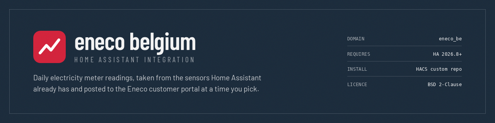

<p align="center">
  
</p>

<p align="center">
  <a href="https://github.com/renaudallard/homeassistant_eneco/releases/latest">
    
  </a>
  <a href="https://github.com/renaudallard/homeassistant_eneco/releases">
    
  </a>
  <a href="https://github.com/renaudallard/homeassistant_eneco/actions/workflows/checks.yml">
    
  </a>
  <a href="https://github.com/renaudallard/homeassistant_eneco/actions/workflows/hassfest.yml">
    
  </a>
  <a href="https://github.com/renaudallard/homeassistant_eneco/actions/workflows/hacs.yml">
    
  </a>
  <a href="https://www.home-assistant.io/">
    
  </a>
  <a href="https://hacs.xyz">
    
  </a>
  <a href="./LICENSE">
    
  </a>
  <a href="https://www.paypal.me/RenaudAllard">
    
  </a>
</p>

---

Sends your electricity and gas meter readings to the Eneco Belgium customer
portal once a day, taking the values from sensors Home Assistant already has.

Eneco lets you enter meter readings by hand at
*My Eneco > Consommation > Encoder un relevé*. If your smart meter is already in
Home Assistant, doing that by hand every day is pointless work. This integration
reads the index of each register from the sensors you choose and posts them to
the portal at a time you pick.

Requires Home Assistant **2026.8** or newer.

## What it does

At the configured local time, once a day, it:

1. reads the current value of the sensor you chose for each register,
2. rounds it to whole kWh for electricity, or whole m³ for gas,
3. posts the set to Eneco, dated today.

Which registers exist is decided by Eneco, not by this integration: it asks the
portal which ones your meter accepts and only offers those. A dual tariff
electricity meter with solar panels typically has four (consumption day,
consumption night, injection day, injection night); a gas meter has one.

**Every register is optional.** Leave one without a sensor and it is simply not
part of the submission, which is what you want when a meter is still read by
hand, or when only some of its registers reach Home Assistant. Set up one entry
per meter: an electricity meter and a gas meter are two entries, and you can add
either without the other.

Among the registers you *did* map, a submission is all or nothing. If one of
those sensors is unavailable or does not report a usable number, nothing is sent
and the reason is recorded, because a partial set would record an incoherent
moment across the registers and the date cannot be submitted again to correct
it.

## Installation

### HACS

Add this repository as a custom repository of type *Integration*, install it,
and restart Home Assistant. Releases ship as a single archive, so downloading
one is a single request rather than a file at a time.

### Manually

Copy `custom_components/eneco_be` into your Home Assistant `config` directory and
restart.

## Setup

*Settings > Devices & services > Add integration > Eneco Belgium*.

1. **Credentials.** The email and password of your My Eneco account.
2. **Account, address, meter.** Only asked when you have more than one; the
   integration skips straight past any step with a single answer.
3. **Meter readings.** A sensor per register, each optional, and the time of day
   to submit.

The sensor for a register must be a *total* index, the same number you would
read off the meter, not a rate or a daily delta. For electricity that is an
energy sensor in kWh; on a Belgian digital meter these are the ones your P1 or
DSMR integration exposes as "total consumption tariff 1", "total production
tariff 2", and so on. For gas it is a volume sensor in m³. Other units of the
same kind are converted automatically.

## Entities

Every entry creates one device, named after the meter's EAN, with:

| Entity | Purpose |
| --- | --- |
| `time.*_submit_at` | The time of day readings are sent; change it here and the schedule moves immediately |
| `sensor.*_next_submission` | When the next submission is due, shown as a countdown |
| `button.*_submit_readings` | Submit the readings now |
| `sensor.*_last_submission` | When the last submission succeeded |
| `sensor.*_status` | How the last attempt went, with the reason as an attribute |

`sensor.*_status` reads `pending` before the first attempt, then `success`,
`already_submitted` when the date was already done, `nothing_to_submit` when no
register has a sensor, or `failed` with the reason in its `last_error`
attribute. Three failures in a row also raise a repair on the dashboard, which
clears itself once a submission lands.

Press the button from an automation if you want a different schedule than the
built-in daily one. A press that cannot submit fails the service call with the
reason, so a script notices; a press on a day that is already done, or with no
register mapped, is a no op rather than an error.

Use *Download diagnostics* on the device to see exactly what was last sent.

What the last attempt did is remembered across restarts, so the sensors carry on
reporting the real last submission rather than resetting, and a day that was
already submitted is not sent again after a restart.

A wall clock trigger cannot fire while Home Assistant is down, so if the
configured time has already gone by when it starts and today has not been
submitted yet, the readings are sent rather than the day being lost. That
happens once Home Assistant has finished starting, not while it is still
loading, so the sensors it reads have had a chance to publish a value. It also
means a freshly configured meter submits as soon as you finish setting it up, if
you chose a time earlier in the day.

## Changing the configuration

To move the **submission time**, set the `time.*_submit_at` entity on the device
page. The schedule is rearmed as soon as you change it, and
`sensor.*_next_submission` updates to match.

To change **which sensor feeds which register**, open the integration page,
click the three dots on the entry and choose *Configure*. The form comes up
prefilled with your current mapping.

*Reconfigure*, in the same menu, walks the whole flow again including the
credentials, which is what you want after a meter change, or if the email
address you sign in to Eneco with has changed. If Eneco stops accepting the
stored password, Home Assistant raises a reauthentication prompt by itself;
that one asks for the password alone, because it is there to re-establish the
account the entry already belongs to.

## Limitations

- **No two-factor authentication.** The login is a plain Okta username and
  password exchange. An account that requires MFA cannot be used headlessly, and
  setup will say so rather than fail obscurely.
- **Whole units.** Eneco stores the index as a 32 bit integer, so values are
  rounded: whole kWh for electricity, whole m³ for gas. A sensor reporting a
  negative index, or one past what the portal can hold, is treated as unusable
  rather than sent.
- **One reading per day.** Eneco rejects a second reading for a date that
  already has one, and rejects any value below the previous reading. Both show up
  on the status sensor.
- **A tariff period this integration does not know is skipped.** The portal
  has no versioning, so if Eneco ever adds one it is left out of the form and
  out of the submission, and the registers alongside it carry on working. The
  Home Assistant log names it.
- Your credentials are stored in the Home Assistant configuration, like every
  other cloud integration.
- **A submission time between 02:00 and 03:00 is affected by daylight saving.**
  On the spring forward night that hour does not exist, so the trigger does not
  fire; the reading is caught up the next time Home Assistant starts, and
  otherwise that day is skipped. On the autumn night the hour happens twice, and
  the second run is a no op because the date has already been submitted. Any
  other time of day is unaffected.

## How it works

The portal has no public API. `docs/API.md` records how the endpoints, payloads
and login sequence were established, from the source maps the site ships in
production. In short: an Okta password grant produces a one-shot session token,
NextAuth trades it for a session cookie, and the session yields the bearer token
the REST API wants.

The daily submission is JSON throughout: every call it makes goes to the same
REST endpoints the website uses. Setting up an entry is the one exception. No
endpoint exposes the list of accounts you may act on, which reaches the browser
only inside the `__NEXT_DATA__` payload the dashboard renders, so that one list
is read out of the page.

## Development

```sh
python3 -m venv .venv
.venv/bin/pip install -r requirements-dev.txt
.venv/bin/ruff format --check custom_components tests tools
.venv/bin/ruff check custom_components tests tools
.venv/bin/mypy custom_components/eneco_be tests tools
.venv/bin/python tools/check-translations.py
.venv/bin/pytest tests -q
```

That is exactly what CI runs, alongside hassfest and the HACS validator.

`ruff` and `mypy` use the same rule set and error codes Home Assistant core
uses, so anything that would fail a core review fails here too.

The formatter targets Python 3.14 and rewrites a multiple exception `except`
clause to the PEP 758 form, which nothing older can parse. Every clause that
affects carries a `# fmt: skip`, and a test parses everything the integration
ships against the previous version of the language to keep it that way.

`tools/license-header.py` adds the licence header to any new source file, and
`tools/check-translations.py` keeps `strings.json`, the translations,
`icons.json` and the code in step.

`tools/check-portal.py` signs in to a real account and reads back the discovery
chain, then the registers and recent readings of every meter it would set up an
entry for, gas as well as electricity, without submitting anything. The portal
has no public API and no versioning, so when something stops working this is
what tells you which endpoint moved:

```sh
ENECO_EMAIL=you@example.com .venv/bin/python tools/check-portal.py
```

The brand images in `custom_components/eneco_be/brand` are what HACS validates
and what Home Assistant serves for the integration.

## Languages

The interface is translated into English, French, Dutch and German. Home
Assistant picks the one matching your profile.

## Licence

BSD 2-Clause. See [LICENSE](./LICENSE).

If this saved you the daily trip to the Eneco website, the PayPal badge at the
top is there.
